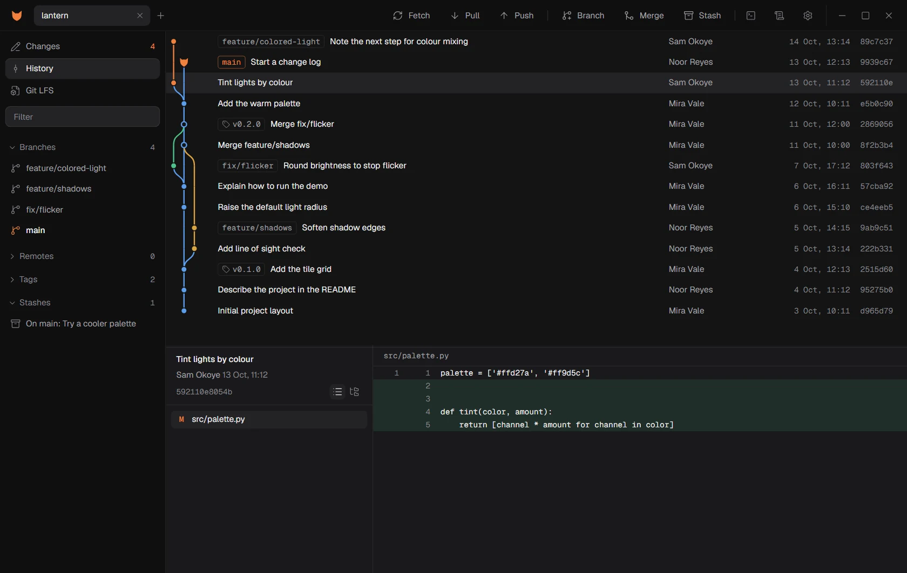
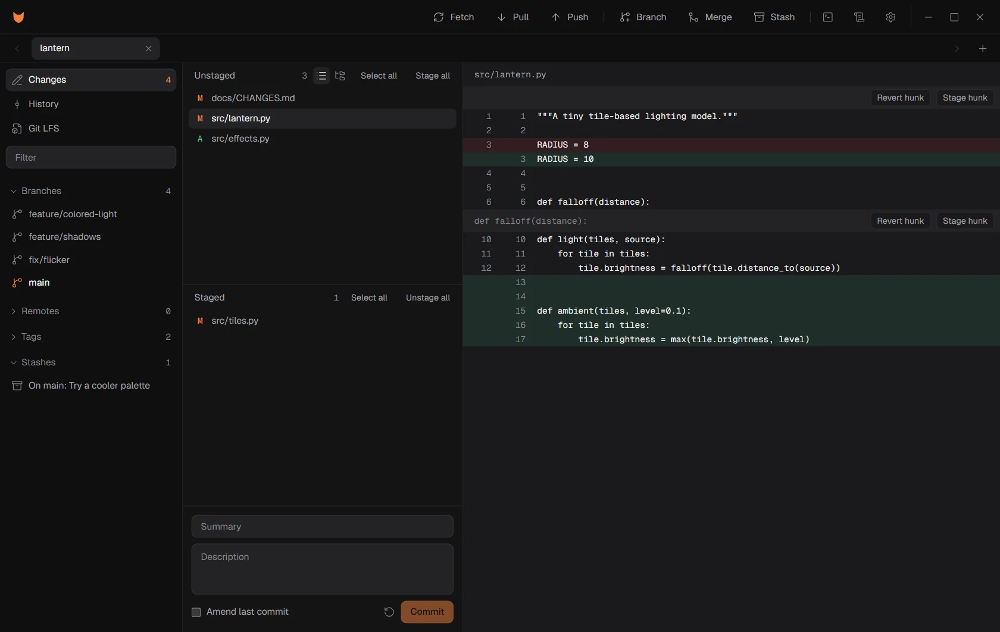
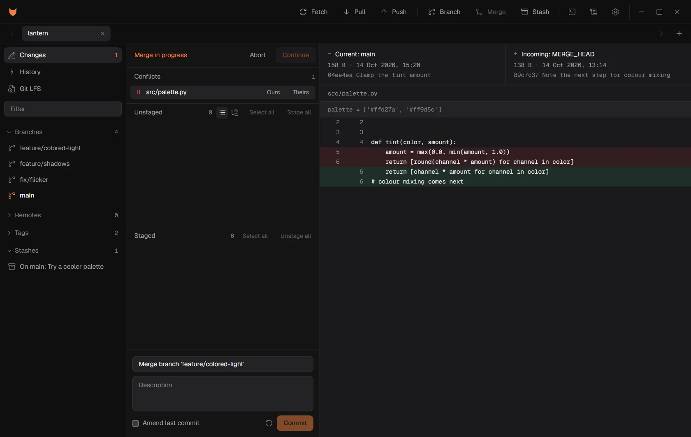
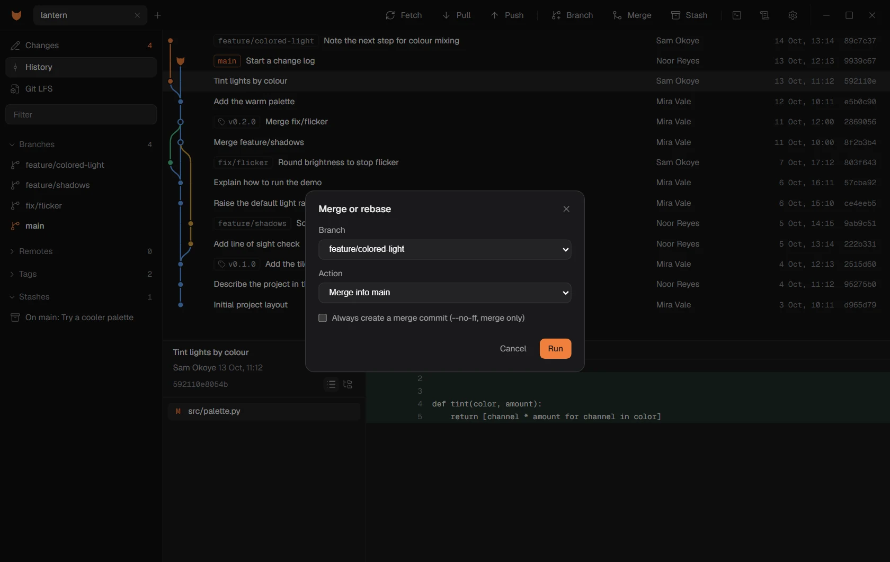
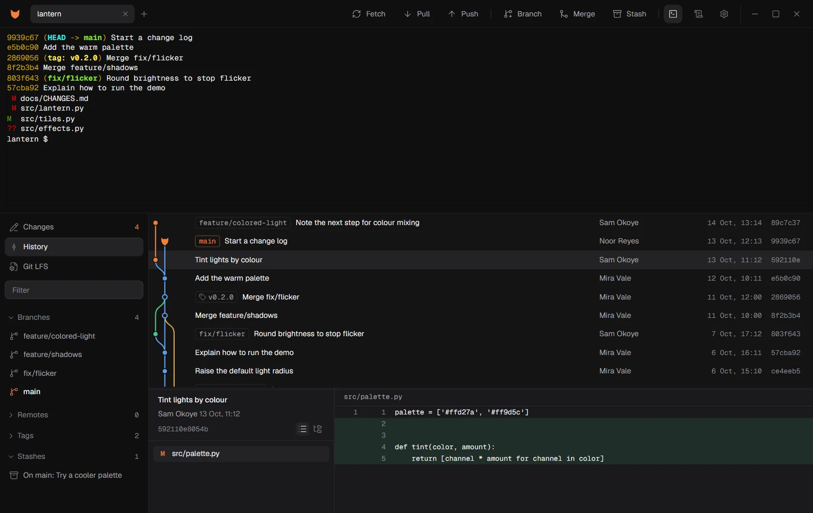

# Fox Git

**English** · [Русский](README.ru.md)

Fox Git is a small Git client for Windows and Linux. Follow branches on the commit graph, stage single
hunks, resolve conflicts, manage stashes, Git LFS and SSH keys, and keep a terminal in the same window.
It runs on the git you already have, so your repositories and settings stay as they are.

**[Download Fox Git](https://lis-carter.site/fox-git/#download)** · [Website](https://lis-carter.site/fox-git/) · [Discord](https://discord.gg/uCd8DH9GVx)



## Features

- **Commit graph.** Branches, merges and tags on one graph, next to a filterable list of branches.
- **Staging by hunk.** Stage, unstage or revert a file or a single hunk. Files show as a list or as folders.
- **Commits.** A summary line and a description, amend the last commit, and the message git prepares for a merge.
- **Merge and rebase.** Merge or rebase branches from the toolbar. For each conflict compare both versions,
  with their dates and a diff, pick ours or theirs, then continue or abort a merge, rebase, cherry-pick or revert.
- **Branches.** Check out, merge, rebase, rename, set an upstream or delete a branch, on the remote too.
  Fetch a remote branch into a local one without switching to it.
- **Built-in terminal.** Open a terminal in the repository. It keeps running while you switch tabs.
- **Stash and tags.** Stash with a description and new files, then apply or delete it. Create tags and check them out.
- **Git LFS.** Enable LFS, edit tracked patterns, and see which files are downloaded and which are still pointers.
- **GitHub and SSH.** Sign in through the browser and find your repositories to clone. Create an SSH key,
  test the connection and add the key to GitHub.
- **Several repositories.** Keep repositories in tabs, drop a folder onto the window, or open one from the terminal.
- **Log.** Every git command and its warnings and errors, in a panel that opens by itself when something fails.
- **Your layout.** Resize the panels, pick English or Russian, one of four palettes or your system accent colour,
  a dark or light theme, and the app's own title bar or the system one.

| Changes | Conflicts |
| --- | --- |
|  |  |
| **Merge and rebase** | **Terminal** |
|  |  |

## Install

Download the files from the [website](https://lis-carter.site/fox-git/#download).
They are also attached to each [release](https://github.com/fly4xy/Fox-Git/releases/latest).

| System | File | How to install |
| --- | --- | --- |
| Windows 10, 11 | `Fox-Git_<version>_x64-setup.exe` | Run the installer |
| Windows 10, 11 | `fox-git.exe` | Portable, runs without installing |
| Ubuntu, Debian | `Fox-Git_<version>_amd64.deb` | `sudo apt install ./Fox-Git_*_amd64.deb` |

You need `git` in `PATH`, and `git-lfs` for the LFS section.

- **WebView2.** Fox Git draws its window with Microsoft Edge WebView2. Windows 11 has it. On Windows 10 install it
  from [Microsoft](https://developer.microsoft.com/microsoft-edge/webview2/) if the app says it is missing.
- **SmartScreen.** The files are not code-signed, so Windows may warn about them. Choose *More info* → *Run anyway*.
- **Open from the terminal.** `fox-git path/to/repo`

## Build from source

You need Node.js 20.19 or 22.12+, Rust stable and git.
On Linux also install the WebKitGTK headers:

```bash
sudo apt install libwebkit2gtk-4.1-dev libgtk-3-dev librsvg2-dev libayatana-appindicator3-dev libdbus-1-dev pkg-config build-essential
```

Run in development mode:

```bash
npm install
npm run tauri dev
```

Build the Windows installer, plus the portable `src-tauri/target/release/fox-git.exe`:

```bash
npm run build:windows
```

Build the Linux packages:

```bash
npm run build:linux
```

The output lands in `src-tauri/target/release/bundle/`.

### GitHub sign-in

Sign-in happens in the browser. Create an OAuth app at https://github.com/settings/developers with the callback
URL `http://127.0.0.1/callback` and with "Expire user access tokens" turned off, since the app does not refresh tokens.

Copy `.env.example` to `.env` and fill in the Client ID and Client Secret. They are built into the app, so users
only press Sign in with GitHub. Without `.env`, Settings asks for both values. A secret built into a desktop app can be
extracted, so use a separate OAuth app for your build. Never commit `.env`.

## Screenshots

`docs/screenshots/` holds the current screenshots of the app, 1680 × 1062 WebP (`palettes.webp` is a crop
of Settings). They are retaken when the interface changes, under the same names:

| File | Shows |
| --- | --- |
| `graph.webp`, `history.webp` | History: the commit graph, a selected commit and its diff |
| `changes.webp` | Changes: unstaged and staged files, a hunk diff, the commit form |
| `branches.webp` | The branch menu |
| `terminal.webp` | The built-in terminal above the history |
| `light.webp` | History in the light theme |
| `merge.webp` | The merge and rebase dialog |
| `conflict.webp` | A merge conflict: both sides and their diff |
| `palettes.webp` | Settings: language, palette and theme |

## Tech

[Tauri 2](https://tauri.app), [Svelte 5](https://svelte.dev) and Rust. All git work goes through the system `git`.

## License

[MIT](LICENSE)
