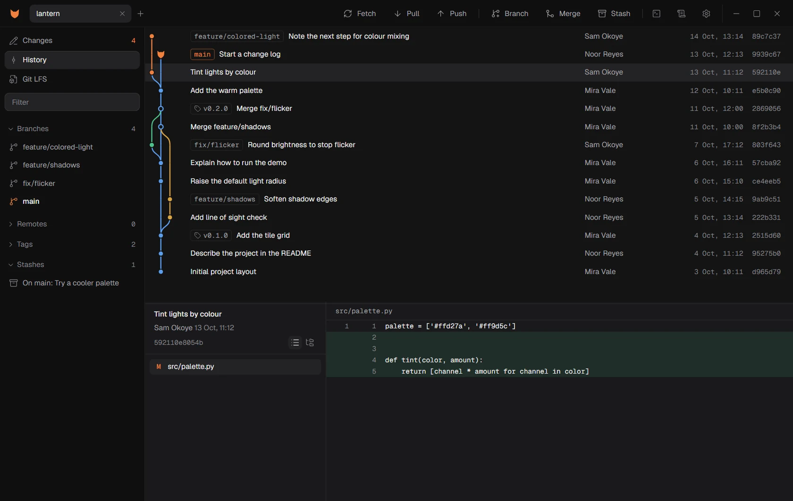
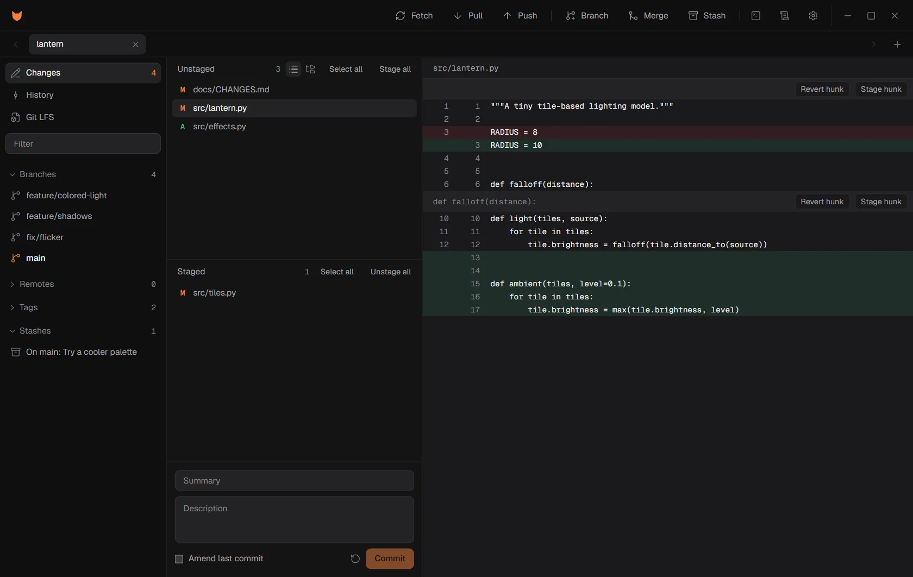
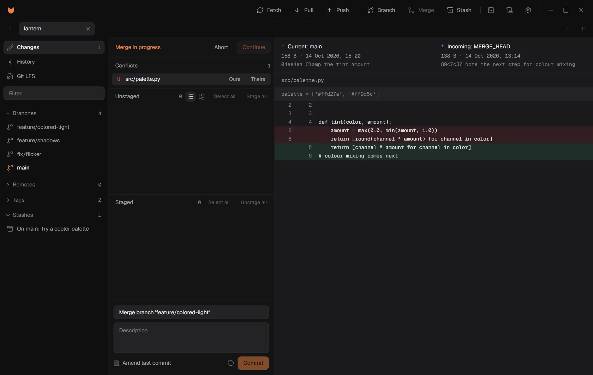
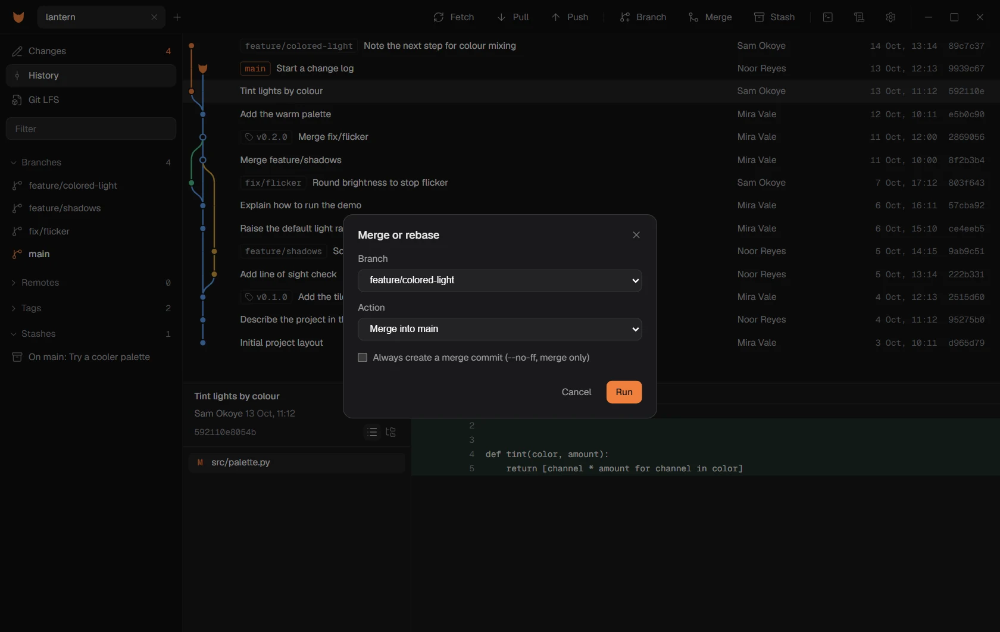
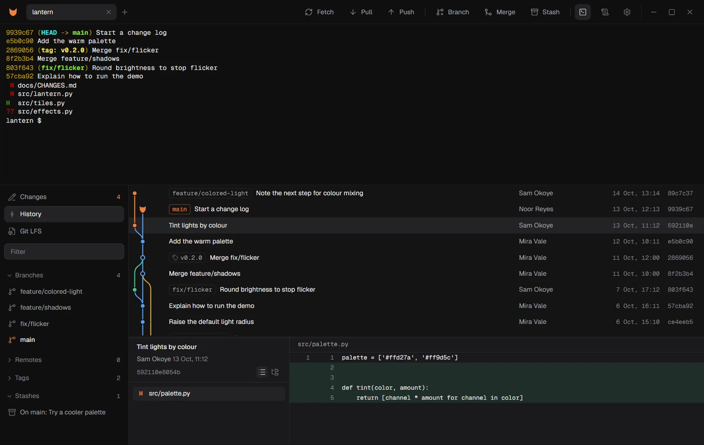

# Fox Git

[English](README.md) · **Русский**

Fox Git — небольшой Git-клиент для Windows и Linux. Следите за ветками на графе коммитов, индексируйте
отдельные фрагменты, разрешайте конфликты, управляйте стэшами, Git LFS и SSH-ключами, держите терминал
в том же окне. Он работает поверх уже установленного git, поэтому ваши репозитории и настройки не меняются.

**[Скачать Fox Git](https://lis-carter.site/fox-git/#download)** · [Сайт](https://lis-carter.site/fox-git/) · [Discord](https://discord.gg/uCd8DH9GVx)



## Возможности

- **Граф коммитов.** Ветки, слияния и теги на одном графе, рядом список веток с фильтром.
- **Индексация по фрагментам.** Добавляйте в индекс, убирайте из него или откатывайте файл целиком или один фрагмент.
  Файлы показываются списком или папками.
- **Коммиты.** Заголовок и описание, исправление последнего коммита и сообщение, которое git готовит для слияния.
- **Слияние и перебазирование.** Сливайте и перебазируйте ветки с панели инструментов. Для каждого конфликта
  сравните обе версии с датами и различиями, выберите свою или чужую, затем продолжите или прервите слияние,
  перебазирование, cherry-pick или revert.
- **Ветки.** Переключение, слияние, перебазирование, переименование, upstream и удаление ветки, в том числе на удалённом
  репозитории. Удалённую ветку можно скачать в локальную, не переключаясь на неё.
- **Встроенный терминал.** Терминал открывается в папке репозитория и продолжает работать, пока вы переключаете вкладки.
- **Стэши и теги.** Стэш с описанием и новыми файлами, применение и удаление. Создание тегов и переход на них.
- **Git LFS.** Включение LFS, правка отслеживаемых шаблонов, какие файлы скачаны, а какие остались указателями.
- **GitHub и SSH.** Вход через браузер и поиск своих репозиториев для клонирования. Создание SSH-ключа, проверка
  соединения и добавление ключа в GitHub.
- **Несколько репозиториев.** Репозитории во вкладках, папку можно перетащить на окно или открыть из терминала.
- **Журнал.** Все команды git, их предупреждения и ошибки в панели, которая сама открывается при ошибке.
- **Под себя.** Размеры панелей, английский или русский язык, одна из четырёх палитр или системный акцентный цвет,
  тёмная или светлая тема, собственный заголовок окна или системный.

| Изменения | Конфликты |
| --- | --- |
|  |  |
| **Слияние и перебазирование** | **Терминал** |
|  |  |

## Установка

Файлы можно скачать на [сайте](https://lis-carter.site/fox-git/#download).
Они также приложены к каждому [релизу](https://github.com/fly4xy/Fox-Git/releases/latest).

| Система | Файл | Как установить |
| --- | --- | --- |
| Windows 10, 11 | `Fox-Git_<версия>_x64-setup.exe` | Запустите установщик |
| Windows 10, 11 | `fox-git.exe` | Портативная версия, работает без установки |
| Ubuntu, Debian | `Fox-Git_<версия>_amd64.deb` | `sudo apt install ./Fox-Git_*_amd64.deb` |

Нужен `git` в `PATH`, а для раздела LFS — `git-lfs`.

- **WebView2.** Окно Fox Git рисует Microsoft Edge WebView2. В Windows 11 он уже есть. В Windows 10, если приложение
  сообщит, что его нет, установите его [с сайта Microsoft](https://developer.microsoft.com/microsoft-edge/webview2/).
- **SmartScreen.** Файлы не подписаны, поэтому Windows может предупредить о них. Нажмите *Подробнее* → *Выполнить в любом случае*.
- **Открыть из терминала.** `fox-git путь/к/репозиторию`

## Сборка из исходников

Нужны Node.js 20.19 или 22.12+, Rust stable и git.
В Linux также установите заголовки WebKitGTK:

```bash
sudo apt install libwebkit2gtk-4.1-dev libgtk-3-dev librsvg2-dev libayatana-appindicator3-dev libdbus-1-dev pkg-config build-essential
```

Запуск в режиме разработки:

```bash
npm install
npm run tauri dev
```

Установщик для Windows и портативный `src-tauri/target/release/fox-git.exe`:

```bash
npm run build:windows
```

Пакеты для Linux:

```bash
npm run build:linux
```

Результат появится в `src-tauri/target/release/bundle/`.

### Вход через GitHub

Вход идёт через браузер. Создайте OAuth-приложение на https://github.com/settings/developers с адресом возврата
`http://127.0.0.1/callback` и выключенным «Expire user access tokens»: приложение не обновляет токены.

Скопируйте `.env.example` в `.env` и впишите Client ID и Client Secret. Они встраиваются в приложение, и пользователю
остаётся только нажать «Войти через GitHub». Без `.env` настройки попросят оба значения. Секрет, встроенный в программу, можно
извлечь, поэтому заведите для своей сборки отдельное OAuth-приложение. Не коммитьте `.env`.

## Скриншоты

В `docs/screenshots/` лежат актуальные скриншоты приложения, WebP 1680 × 1062 (`palettes.webp` — фрагмент настроек).
Когда интерфейс меняется, их переснимают под теми же именами. Что на каком, описано в [английском README](README.md#screenshots).

## Технологии

[Tauri 2](https://tauri.app), [Svelte 5](https://svelte.dev) и Rust. Вся работа с git идёт через системный `git`.

## Лицензия

[MIT](LICENSE)
